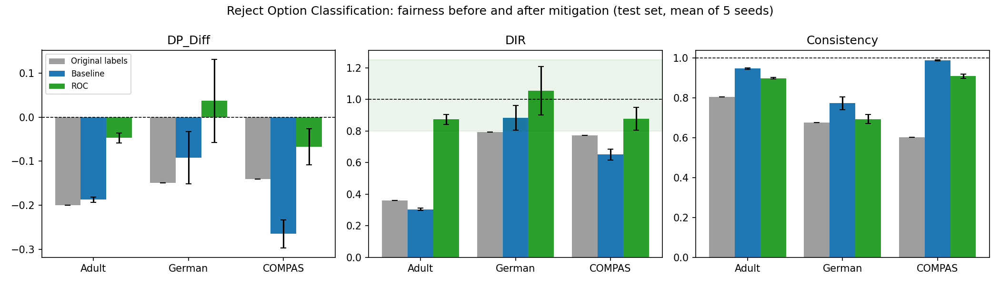

# Reject Option Classification for Fair Classification – Adult, German Credit, COMPAS (run 3)

Code for Assignment 4 (Algorithmic Fairness), written from scratch with Genie Code. It evaluates the **Reject Option based Classification (ROC)** post-processing algorithm of
F. Kamiran, A. Karim and X. Zhang, *Decision Theory for Discrimination-Aware Classification*, IEEE ICDM 2012.

## What the notebook does
1. Loads three datasets with a binary protected attribute S (1 = privileged) and a binary favourable label Y = 1.
2. **Before mitigation:** DP_Diff, Disparate Impact Ratio (DIR) and Consistency of the original labels.
3. Stratified 70/30 train/test split (on Y × S); the training part is split again 70/30 into fit/validation.
4. Trains logistic regression on the fit split (baseline, threshold 0.5).
5. Tunes ROC on the validation split: threshold θ and critical-region half-width ω, maximising balanced accuracy subject to |DP_Diff| ≤ 0.05. Inside |p − θ| ≤ ω the unprivileged group gets the favourable label and the privileged group the unfavourable one.
6. **After mitigation:** DP_Diff, DIR, Consistency, accuracy, balanced accuracy and F1 on the test set; 5 seeds, mean ± std; before/after plot.

ROC and the metrics are implemented from their definitions (conventions as in AIF360); sanity tests on small examples with known answers are included.

## Datasets
Place the files in `DATA_DIR` (default: the parent `fairness_assignment4` folder):

| Dataset | File | Protected attribute (privileged) | Favourable label |
| --- | --- | --- | --- |
| Adult | `adult.csv` (UCI Adult, CSV with header) | sex (male) | income > 50K |
| German Credit | `statlog+german+credit+data/german.data` (UCI Statlog) | age > 25 | good credit |
| COMPAS | `propublica_data_for_fairml.csv` (ProPublica, FairML version) | race (non-African-American) | no two-year recidivism |

## How to run
```bash
pip install -r requirements.txt
export DATA_DIR=path/to/data
jupyter notebook ROC_Fairness_Evaluation.ipynb
```
Runtime is about one minute.

## Results (test set, mean over 5 seeds)
| Dataset | Stage | DP_Diff | DIR | Consistency | Accuracy | Bal. acc. |
| --- | --- | --- | --- | --- | --- | --- |
| Adult | Original labels | −0.200 | 0.362 | 0.805 | – | – |
| | Baseline | −0.187 | 0.304 | 0.946 | 0.848 | 0.769 |
| | ROC | −0.047 | 0.874 | 0.898 | 0.787 | 0.788 |
| German | Original labels | −0.149 | 0.795 | 0.675 | – | – |
| | Baseline | −0.092 | 0.884 | 0.772 | 0.751 | 0.665 |
| | ROC | +0.037 | 1.055 | 0.693 | 0.721 | 0.706 |
| COMPAS | Original labels | −0.140 | 0.773 | 0.603 | – | – |
| | Baseline | −0.265 | 0.651 | 0.987 | 0.671 | 0.662 |
| | ROC | −0.067 | 0.879 | 0.908 | 0.658 | 0.657 |



## Repository contents
* `ROC_Fairness_Evaluation.ipynb` – complete pipeline
* `requirements.txt` – dependencies
* `roc_before_after.png` – figure produced by the notebook
* `Assignment4_Report_run3.html` – report (paper review + results)
